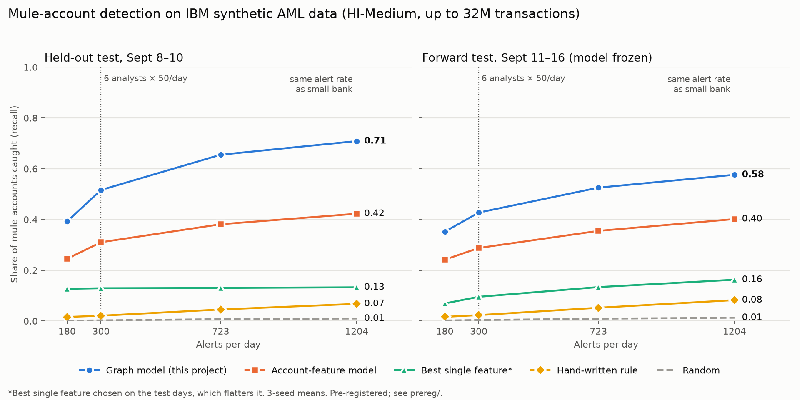

# Veritas: mule-account detection at a fixed analyst budget

Veritas is a graph-based detector for money-mule (pass-through) accounts, built for the alert volume a small or mid-size bank's analyst team can actually work. It runs on IBM's synthetic AML transaction data, so it says nothing yet about real bank data.



## Headline results
HI-Medium was never used during development. Both tests were pre-registered before they ran (`prereg/`). Numbers are 3-seed means.

| Test | Alerts/day | Mules caught (recall) | Precision | Alerts per true mule |
|---|---|---|---|---|
| HI-Medium, Sept 8–10 (813 mules) | 300 (6 analysts × 50) | 0.52 | 47% | 2.1 |
| | 1,204 (same alert rate as HI-Small) | 0.71 | 16% | 6.3 |
| HI-Medium forward, Sept 11–16 (2,064 mules), model frozen since Sept 7 | 300 | 0.43 | 49% | 2.0 |
| | 1,204 | 0.58 | 16% | 6.1 |
| HI-Small, Sept 8–10 (182 mules; development data) | 300 | 0.59 | 12% | 8.4 |

On the same alerts, compared with simpler detectors:

| Detector | HI-Medium Sept 8–10 @300/day | Forward Sept 11–16 @300/day |
|---|---|---|
| Random | 0.002 | 0.004 |
| Hand-written pass-through rule | 0.021 | 0.023 |
| Best single feature (chosen on the test days) | 0.129 | 0.095 |
| Gradient-boosted model, 19 account features | 0.310 | 0.288 |
| **Graph model (this project)** | **0.516** | **0.427** |
| Graph model trained on shuffled labels (placebo) | 0.002 | 0.002 |

## Honest reading
- The graph features add a lot: about 1.5–1.7× the recall of the same model without them, and 4× the best single feature.
- **The forward test missed its pre-registered bar** (0.45 recall at 300 alerts/day; it got 0.43). Precision held at 49% (47% on Sept 8–10), so there's no sign the ranking got worse. What changed was volume: about 27% more mules per day (344 vs 271), and 2,064 mules for 1,800 alerts. Even a perfect model couldn't have passed 0.87 recall. This looks like a capacity problem, not model drift. IBM's generator doesn't adapt the way real launderers do, so this test can't show concept drift either way.
- A fixed team of 6 analysts catches about half the mules at the larger institution. At the same alert rate as the small one, it catches 71%.

## What it means for an analyst team
Same team (6 analysts × 50 alerts/day), same 900 alerts over Sept 8–10 on HI-Medium (813 mules):

| Detector | Mules found | Alerts per mule found | Analyst time per mule found* |
|---|---|---|---|
| Hand-written pass-through rule | 17 | 53 | ~9 h |
| Gradient-boosted model, account features only | 252 | 3.6 | ~35 min |
| **Veritas (graph model)** | **420** | **2.1** | **~20 min** |

\*Assumes the 50 alerts/day budget is one 8-hour day, so about 10 minutes per alert. Real triage time varies a lot by alert type and tooling.

On the forward test (Sept 11–16, model frozen) the same team found 881 of 2,064 mules at 2.0 alerts per mule. Precision held. Recall fell because there were more mules than alerts.

Dollar impact isn't reported yet. It needs the alerted account lists saved per run, which the current pipeline doesn't do.

## Method
1. **Daily causal snapshots.** Each day, every account with both inflow and outflow in the past 72 hours gets features that use only earlier transactions: volume, pass-through ratio, holding time, new counterparties, account age, prior history and shared senders/payees.
2. **Graph features:**
   - neighbour pass-through and account age;
   - 2-cycles and scatter-gather motifs;
   - *matched forwarding*: an inflow followed within 48h by an outflow of 80–100% of the amount (accounts with ≤ 60 transactions).
3. **Score propagation.** A first model scores every account. Each account then gets features describing its senders' and payees' scores (1 and 2 hops), and this repeats for 3 rounds. Scores on training days are out-of-fold by account, so labels don't leak through neighbours.
4. **Model.** LightGBM. Trained on labels from Sept 1–3, early-stopped on Sept 6–7.
5. **Alerts.** Each test day, the top-K accounts go to analysts. An account already alerted isn't alerted again.

A positive is an account that both sent and received a laundering transaction during the test days (an intermediary, not a victim or an end recipient).

## Integrity checks
- **Pre-registration.** HI-Medium tests and the forward test were written up before running (`prereg/`). Nothing was tuned on HI-Medium.
- **Placebo.** The full pipeline trained on labels shuffled within each day scores at random level (0.002).
- **Causality** (checked on HI-Small). Day-8 features are identical whether or not the data after Sept 8 exists. An earlier bug (snapshots included transactions stamped exactly midnight the next day) was found by this check and fixed before any number here.
- **Port check.** The step-4 research script and this repo's code produce identical snapshot features.
- **Run-to-run noise.** Polars' multithreaded aggregation isn't bit-for-bit deterministic. The same seed can move by up to about 0.03 between runs; 3-seed means move by about 0.01. Two runs of this repo on HI-Medium Sept 8–10 gave 0.516 and 0.529; the original script gave 0.528–0.529. The tables use the first run.

## Limits
- **Synthetic data only** (IBM AMLworld). Real mule behaviour, data quality and label lag differ.
- **Development history.** About 17 configurations were compared on HI-Small Sept 8–10 during development, so the HI-Small number is optimistic. HI-Medium is the clean test.
- **Low-illicit data** (LI-Small) is much harder: 0.44 recall at 300/day in development.
- **Low precision at small scale:** 12% on HI-Small, so about 8 alerts per mule found.
- **Currency conversion** uses rates implied by the whole file. These are not labels, but they are not strictly causal.
- **No retraining in the forward test.** In production you'd retrain as labels come in.

## Production gaps
What would have to change before this ran at a bank:
- **Simulator bias.** IBM's generator plants laundering in eight templates. In HI-Small's pattern file: cycle 54, gather-scatter 51, bipartite 49, fan-out 48, scatter-gather 44, stack 43, random 41, fan-in 40 attempts. The graph features (2- and 3-cycles, scatter-gather, matched forwarding) are built to find those shapes, so part of the lift is likely the model learning the generator. Real mule networks are messier. The first real-data test should look at how much the motif features add on their own.
- **Why precision is high here, and why it won't hold.** 47–49% precision is a property of the synthetic data, not something to expect at a bank:
  - *Perfect labels.* Every laundering transaction is labeled. At a bank many alerts on real mules are never confirmed, so they count as false positives.
  - *Template laundering.* IBM plants laundering in 8 fixed shapes, and the graph features look for those shapes.
  - *Clean mules.* Synthetic mules forward near-identical amounts with no cover activity and don't adapt after being caught.
  - *Few legitimate look-alikes.* No P2P, and few landlords, payroll or small-business accounts that pass money through for honest reasons. These are the main source of false positives in real mule detection.
  - *Clustered positives.* Whole laundering chains count as positives, so finding one mule often finds its neighbours.

  What should carry over is the ranking against the baselines and the method of scoring at an alert budget. Expect absolute precision to fall sharply on real data.
- **Label lag.** Training uses labels from Sept 1–3 to score Sept 8. Confirmed-mule labels at a bank arrive weeks or months later (case closure, SAR decisions, customer complaints). The next test is training with labels lagged 30+ days.
- **Reason codes.** Analysts get a score, not a reason. A production version needs the top contributing features per alert (for example SHAP values) in plain language: "received 9 new senders in 48h and forwarded 95% to 2 accounts already flagged".
- **Retraining and monitoring.** The forward test showed no loss of precision over 8–13 days without new labels, but real launderers adapt and synthetic ones don't. A deployment needs a retraining cadence, drift monitoring on feature distributions and alert hit rate, and a fallback rule set. See [MODEL_CARD.md](MODEL_CARD.md).
- **Data the dataset lacks.** No KYC, device, IP, login, account-opening channel or customer age. These are usually the strongest real mule signals and would sit alongside the graph features.

## Compared with published results
The dataset paper ([Altman et al., NeurIPS 2023](https://arxiv.org/abs/2306.16424)) benchmarks graph neural networks and gradient-boosted models using **minority-class F1 on individual transactions**. This project scores **accounts** (pass-through intermediaries) by **recall at a fixed daily alert budget**, because that is the decision an analyst team faces. The two numbers measure different things and can't be compared directly. A like-for-like comparison would mean running the paper's models through this alert simulation, which hasn't been done.

## Reproduce
Needs Python 3.10+ and about 16 GB RAM for HI-Medium. Runs in about 10 minutes per configuration on a laptop.
```
pip install -r requirements.txt
# download HI-Small_Trans.csv and HI-Medium_Trans.csv into data/ (see Data below)
python src/prep_data.py data/HI-Small_Trans.csv  2022-09-11 data/hi_sep10.parquet
python src/prep_data.py data/HI-Medium_Trans.csv 2022-09-11 data/himed_sep10.parquet
python src/prep_data.py data/HI-Medium_Trans.csv 2022-09-17 data/himed_sep16.parquet
python src/pipeline.py --data data/hi_sep10.parquet --mode full
python src/pipeline.py --data data/himed_sep10.parquet --mode full --scale-ref data/hi_sep10.parquet
python src/pipeline.py --data data/himed_sep16.parquet --last-day 16 --test 11 12 13 14 15 16 --mode full --scale 4.0144
# same three with --mode baselines, then:
python src/chart.py
```

## Data
IBM Transactions for Anti Money Laundering (Altman et al., NeurIPS 2023 Datasets & Benchmarks): [Kaggle](https://www.kaggle.com/datasets/ealtman2019/ibm-transactions-for-anti-money-laundering-aml), [IBM/AML-Data](https://github.com/IBM/AML-Data). The data is under CDLA-Sharing-1.0 and isn't included in this repo.

## Layout
- `src/`: `load.py` (CSV to USD), `features.py` (snapshots), `chain.py` (neighbour scores), `model.py`, `pipeline.py`, `prep_data.py`, `chart.py`
- `prereg/`: pre-registrations, written before each test
- `results/`: logs, CSVs and the chart
- `MODEL_CARD.md`: intended use, limits, monitoring and retraining plan

## License
Code: MIT (see `LICENSE`). Data: IBM AMLworld, CDLA-Sharing-1.0, not included.
